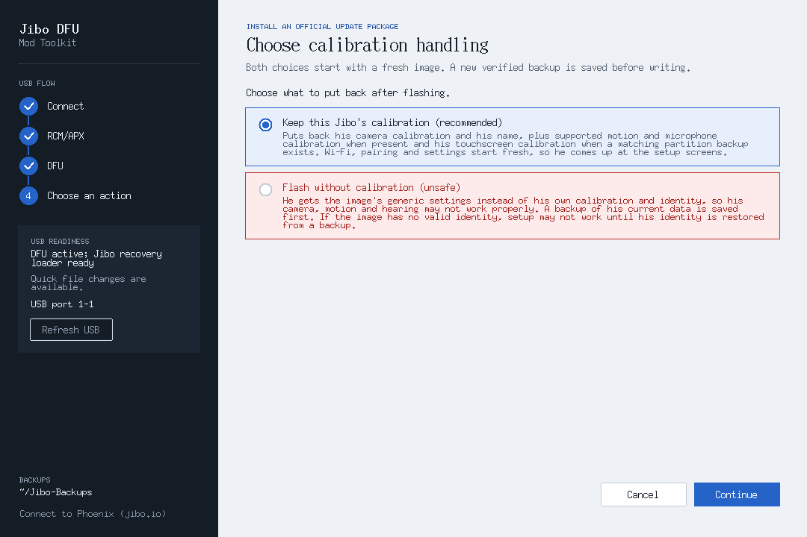
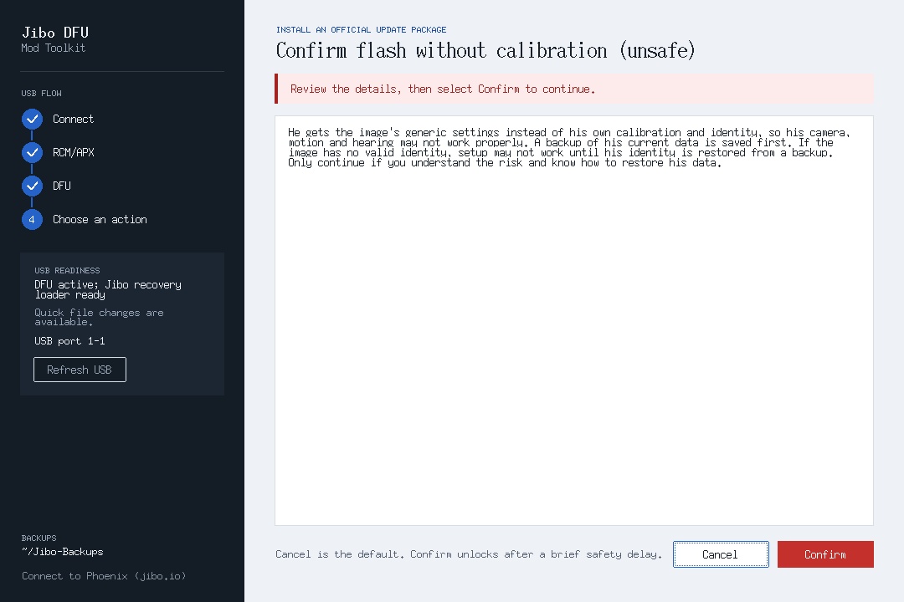

# Graphical Jibo DFU Toolkit

The Tkinter/ttk window is the **recommended entry point** in the README and
a view of the existing guided toolkit. The launch behavior is unchanged:
`run.sh` and `run.ps1` without a GUI flag still open the original text menu.
No drawing or image of Jibo is used. The GUI does not add another flashing
implementation or bypass the backend's validation, backups or confirmations.

## Launch

Keep the launchers in the toolkit folder. First launch may build the existing
ShofEL helper/package and ask for administrator authorization. This is host
setup, not permission to flash a robot: device writes have a separate review.

| Platform | Double-click entry | Terminal equivalent |
| --- | --- | --- |
| Linux x86_64 | `Jibo DFU Toolkit.desktop` | `./run.sh --gui` |
| Windows x64 with WSL 2 + WSLg | `run-gui.cmd` | `.\run.ps1 -Gui -Distro Ubuntu-22.04` |
| macOS Intel / Apple silicon | `Jibo DFU Toolkit.command` | `./run.sh --gui` |

- **Linux:** the desktop file locates the adjacent `run-gui.sh` using its own
  path, including folders with spaces. It requests a terminal for `sudo`,
  initial-build output and fallback messages. Some file managers require
  **Allow Launching**, **Trust**, or executable permission; copying it away
  from the toolkit is not supported. `./run-gui.sh` is also available.
- **Windows:** this uses the same WSL 2 / usbipd USB handoff as the TUI, not a
  native Windows DFU driver. WSLg displays the Linux Tk window on Windows.
  Install WSL/Ubuntu and usbipd-win as described in the README. Run
  `wsl --update`, then `wsl --shutdown` if WSLg is unavailable. The `.cmd`
  wrapper uses a process-local PowerShell execution-policy override, never a
  machine-wide policy change. Extra switches such as `-Distro` and `-ManualUsb`
  can be supplied when invoked from a terminal.
- **macOS:** keep native Python, libusb, dfu-util and e2fsprogs installed as
  described in `docs/macos.md`. Install the Tk package matching your Python,
  e.g. `brew install python-tk@3.12` for Python 3.12, or the matching
  MacPorts `py312-tkinter` port. Finder may require **Open** or permission to
  launch a downloaded shell script. The entry opens Terminal; it is not a
  signed/notarized `.app`. No macOS `sudo` is added.
- **Missing Tk/display:** the Python GUI entry prints platform-specific fixes
  and opens the unchanged text menu only if an interactive terminal exists.
  With no terminal it exits with code 2 rather than hanging. Linux's launcher
  attempts to install its Tk dependency through the existing supported host
  package-manager path. GUI `sudo` preserves only the desktop variables
  `DISPLAY`, `XAUTHORITY`, `WAYLAND_DISPLAY`, `XDG_RUNTIME_DIR`.
- The graphical modules are included in the Linux `.pyz`. Its cached-package
  check compares both GUI modules, so a stale GUI triggers a rebuild.
  `python3 dist/jibo-dfu-linux-x86_64.pyz gui` (or `--gui`) selects the window;
  no arguments still select the TUI. Tk remains a system Python dependency,
  not bundled native libraries in the archive.

## Screens and operations

The [README gallery](../README.md#gui-screenshots) shows the ready, mode/Wi-Fi,
write review and backup progress screens. The optional
[Phoenix connection path](phoenix-nudge.md) has companion screenshots and its
exact wording documented separately.

The sidebar continuously checks the USB connection while idle. Its four-item
**USB FLOW** is the only numbered USB sequence; the state card is labelled
**USB READINESS** rather than repeating the TUI's separate three-step count.
RCM/APX and DFU are distinct; partition operations require the toolkit loader
marker and `var` alternate. Multiple robots, missing/incomplete loader, access
errors and failed enumeration disable unsafe actions. A failed check does not
keep previously ready actions enabled. **Refresh USB**, F5 or Ctrl+R retries.

Available operations use `jibo_tui.execute_action()` and the original
`jibo_dfu` / `jibo_images` implementations:

- **Enter DFU with ShofEL:** review the Meerkat Rev02 RAM-slot warning and
  explicitly approve starting the RAM loader. This step does not write eMMC.
  When DFU appears, the toolkit waits for USB access and the recovery loader to
  settle for up to 25 seconds, never past the entry timeout.
- **Mode / Wi-Fi:** normal, developer, int-developer and OOBE, protected or
  open networks, repeated hidden password entry, quick file editing where
  supported, and the same explicit slower full-var fallback.
- **Set mode and configure Wi-Fi:** developer modes show a checked-by-default
  **Show Wi-Fi status and IP on the boot screen** checkbox. Checked maps to
  the existing `install` choice; unchecked maps to `keep` (leave unchanged),
  **not removal**. The separate Remove button maps to `remove`. Install and
  removal use the existing 500 MiB full-var transaction with rollback and
  SHA-256 readback; the exact shared review still precedes writing.
- **Save/check var backup:** reuse the backend's verified robot-specific
  baseline, show transfer progress and the resulting path.
- **Flash a package:** select from the toolkit folder's `updates` directory or
  choose a hosted Phoenix image. The default is **Keep this Jibo's calibration
  (recommended)**; the only alternative is **Flash without calibration (unsafe)**.
  Both write fresh var, save a fresh verified backup before writing and review
  the full-flash plan. Unsafe is red and requires a separate confirmation with
  **Cancel** focused by default. Declining it writes nothing.
- **Keep calibration:** restores camera measurements and his name, plus supported
  motion/microphone files when present. Touchscreen calibration and the factory
  record require existing verified same-robot rootfs/skills partition backups.
  Wi-Fi, pairing and settings start fresh in OOBE. Without calibration uses
  the package var unchanged; without a valid identity, setup may not work until
  his identity is restored from a backup.
- **Phoenix images:** the latest image is featured at the top of the same flash
  list as local packages, labelled **downloads from jibo.io when you flash**.
  Choose calibration handling first. Download and checks run on the worker thread
  with a **Cancel download** button (Esc also cancels), then the review, write and
  readback follow in one flow. The downloaded image, receipts and working images
  are removed after success, a failed write or a cancelled review. Robot backups
  and your own packages stay. Only interrupted downloads are kept for resume.
  Phoenix writes always read back every transferred prefix. Their review states:
  **This image connects Jibo to Phoenix (jibo.io). After flashing he starts at the
  setup screens; finish setup at jibo.io.** Ordinary package reviews omit this line.
  See [Phoenix images from jibo.io](hosted-flash-images.md).
- **Interrupted flash:** keep the rollback copy and record. Resume currently
  refuses before USB action; select the package again for a new reviewed flash.
  For ordinary packages, the CLI's `--verify-readback` enables full prefix checks.
- **More tools:** partition-layout check, selected-partition backup/restore,
  writing an edited var image, inspecting/editing local backups, and
  **Remove boot-screen Wi-Fi/IP status**. To restore only var from a backup
  set, choose the manifest/folder and select only var. To write a standalone
  var image, use **Write an edited var image**; the backend still validates
  its size and image before the write review.

Radio choices use Up/Down and Enter; partition checklists use Up/Down, Space,
A (select all), N (clear), then Enter. Tab reaches buttons and text fields.
Esc cancels the open question. Image/manifest inputs include file/folder
pickers. Review text and long logs are scrollable and selectable/copyable.

## Flash-choice screenshots





These neutral documentation fixtures are captured with
`scripts/flash_docs_screenshots.py`; they never access USB.

## Safety and threading contract

`jibo_gui_core.py` loads a **private copy** of `jibo_tui` and adapts only its
four prompt primitives. The normal TUI module is not modified. Reviews,
Cancel/Confirm choices, full-var fallback warnings, backend confirmation
callbacks, GPT/identity/hash/size checks and result semantics stay shared.
The GUI omits the menu's “quick edit” capability suffix from visible titles
because boot-status or fallback operations can use full-var instead.

- Cancel is focused by default. Enter on initial focus cancels; there is no
  “yes” default, implicit approval, auto-confirm or timer that approves.
- Confirm is disabled for 700 ms on each review to stop a carried double-click
  from the previous page. It then becomes available but still needs an
  explicit click or focused keyboard invocation. The footer explains this.
- Only one action runs at a time. Duplicate starts are refused immediately,
  including while a question is open. Actions and USB probes share a lock;
  stale probe results cannot overwrite a running action's state.
- Tk runs only on the main thread. Backend work runs on a non-daemon worker
  and sends prompt/output/result events through a queue. Stdout/stderr
  progress becomes a stage label, numeric progress when available, and a
  bounded operation log; percentage is for the current backend stage.
- Closing during a transfer is refused. Closing at an unanswered question
  asks **Cancel and quit?**, with No as the default. Shutdown checks under
  the controller lock that the prompt is still unanswered: a recently
  approved prompt cannot be mistaken for a cancellable question.
- No interrupt button is provided for an active write. Wait for completion;
  forcibly killing Python or removing USB can still interrupt a transfer.
- Password inputs are masked, not added to review/log output, and cleared
  when submitted or cancelled. This is not a claim of cryptographic memory
  erasure in Python/Tk. Synthetic test passwords are used in verification.

## Offline verification

The tests use synthetic ext4 filesystems, test-only signing keys and isolated
USB boundaries. No automated test flashes a robot. Headless tests cover shared
flows and backend safety; opt-in real-window tests exercise actual Tk widgets:

```sh
python3 -m pytest -q tests
JIBO_GUI_TEST_DISPLAY=1 xvfb-run -a python3 -m pytest -q tests
python3 -m unittest discover -s tests
```

Real-window tests require Tk and a display. Screenshot fixtures contain neutral
example packages and settings, not robot data. The gallery never draws Jibo.

Windows and Linux GUI/USB flows and the Intel Mac toolkit have previously been
owner-tested. Apple silicon remains experimental. This calibration flash change
still needs separately authorized hardware boot, readback and recovery acceptance.
