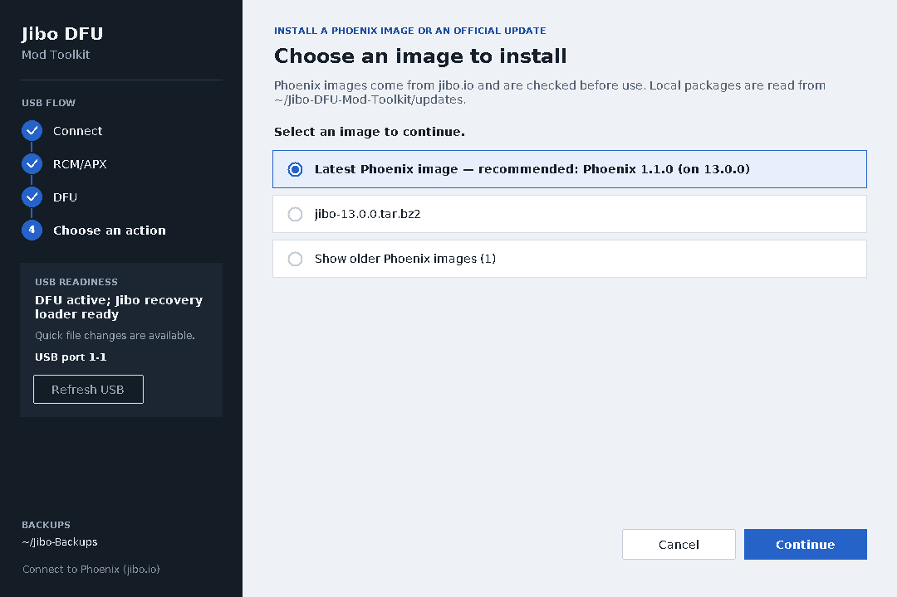
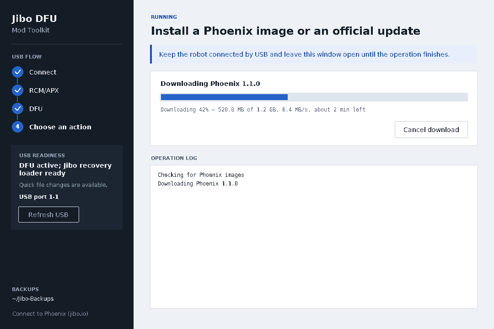

# Phoenix images from jibo.io

The toolkit can download a Phoenix image from jibo.io and install it with the
same reviewed full-flash steps it uses for official update packages. This page
explains what that does, what it keeps, and what it cannot fix.

## What a Phoenix image is

A Phoenix image is a complete set of Jibo's userspace filesystems built on the
official 13.0.0 release, with Phoenix changes so the robot can reach a Phoenix
server instead of the retired Jibo cloud. It is not an official Jibo release,
and the toolkit says so on the review screen.

Each image is listed in a signed catalog on jibo.io. The toolkit checks the
signature of the list and the checksum of every download before it offers the
image for install. A download that does not match is not used.

## Where to find it

- **Install a Phoenix image or an official update** (robot in DFU): the image
  list opens with **Latest Phoenix image — recommended** at the top, then your
  local packages from the `updates` folder in their usual order, then
  **Show older Phoenix images**.
- **Download a Phoenix image (no robot needed)**: download and check an image
  now, install it later. Downloading never touches USB.

If jibo.io can't be reached, the list says so in one line and your local
packages still work. If the toolkit has a saved copy of the last list, it shows
that and says it is the last checked list.

Downloads go to the toolkit's `updates` folder. **Cancel** keeps what was
already saved; choosing the same image again continues from there. In the
graphical window, closing during a download asks first, then stops the download
without touching the robot. While an image downloads, the progress page shows
how much is done, the speed and the time left.

The two pictures above use example image names, sizes and folders.

## Calibration choices

Every package offers exactly two choices:

- **Keep this Jibo's calibration (recommended)** — preselected. Fresh var gets his
  camera calibration and name, plus supported motion/microphone files when present.
  Touchscreen calibration and the factory record require existing verified same-robot
  partition backups. Wi-Fi, pairing and settings start fresh at the setup screens.
- **Flash without calibration (unsafe)** — red. Writes the package var unchanged,
  with generic settings instead of his own calibration and identity. Camera, motion
  and hearing may not work properly. If the image has no valid identity, setup may
  not work until his identity is restored from a backup. It needs a separate explicit
  confirmation with **Cancel** selected by default.

Both choices read and verify the current var before any partition write. An older
backup never replaces that fresh read. The private rollback backup remains available
for recovery.

## The review before anything is written

Selecting an image or finishing a download never starts a flash. Review the package,
calibration choice, official base, checksums, partitions and limitations first.
**Cancel** is the default at every confirmation. Nothing is written unless you
explicitly confirm. Phoenix images always read every transferred prefix back.

The review of an authenticated Phoenix image states:

> This image connects Jibo to Phoenix (jibo.io). After flashing he starts at the setup screens; finish setup at jibo.io.

Interrupted flashes cannot currently resume; the toolkit refuses before USB action.
Keep the saved backup and record, then select the package for a new reviewed flash.

## What it does not fix

An install rewrites the userspace filesystems (both root slots, services and
skills) and this robot's var. It does not change or repair the boot chain
(boot0/boot1, BCT), fuses, or the partition table (GPT). A robot that can't
reach DFU, or whose partition table is damaged, needs a different recovery.

Only var gets a rollback copy. Other partitions can be restored from an official
update package.

## Related

- [Graphical interface](gui.md)
- [RTM images and factory calibration](rtm-images-and-calibration.md)
